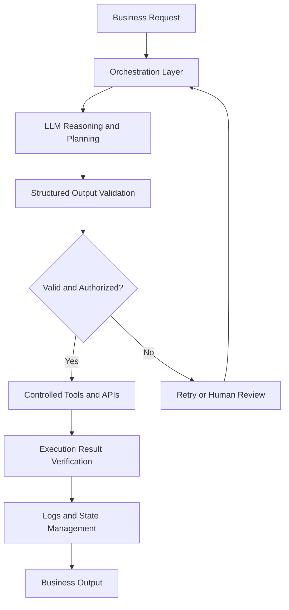

# Vikrant Kulle
### AI Solutions Engineer | Full-Stack Developer | Software Automation Architect

**I build production-ready software, integrate AI into business workflows, and automate complex operations.**

I work with founders, growing businesses, and engineering teams to turn business requirements into reliable software—from solution architecture and AI integration to testing, deployment, and ongoing improvement.

[Portfolio](https://vstechworks.co.in/) · [LinkedIn](https://linkedin.com/in/vikrant-kulle) · [Email](mailto:vikrantkulle392000@gmail.com)

**Open to:** Freelance Projects · Contract Engagements · Remote Engineering Roles

---

## Professional Profile

I combine enterprise software engineering experience at Capgemini, including work on Hartford Insurance's Guidewire PolicyCenter platform, with hands-on development of web applications, business automation systems, and AI-powered solutions.

My approach combines practical engineering, structured problem-solving, and quality assurance to deliver systems that are maintainable, testable, and ready for real-world use.

**What I bring to a project**

- **AI Engineering & Integration:** LLM-powered applications, tool calling, structured outputs, retrieval-augmented generation (RAG), and agent workflows.
- **Custom Software Development:** Full-stack web applications, business portals, progressive web applications, and API-driven systems.
- **Workflow Automation:** Replacing repetitive manual processes with reliable, traceable software workflows.
- **Quality Engineering:** Automated UI and API testing, regression prevention, error handling, and production-readiness validation.
- **End-to-End Delivery:** Requirements discovery, architecture, implementation, deployment, and technical documentation.

## Selected Projects

Production websites and commercial software projects developed for businesses and product initiatives.

### 1. Admissions Made Easy
**Education Technology · Admissions & Counselling Platform**

Website: https://admissionsmadeeasy.in/

A platform designed to help students navigate complex medical and engineering admissions through college discovery, cutoff analysis, counselling information, and digital support services.

- Developed a digital platform for admissions-related information and student services.
- Focused on simplifying information discovery and complex admission workflows.
- Supported the delivery of student-facing features and online counselling experiences.

**Technologies:** Next.js · TypeScript · Tailwind CSS · REST APIs · Playwright

### 2. Anmol Enterprises
**B2B Commerce · Progressive Web Application**

Website: https://anmolenterprisess.in/

A digital storefront and wholesale ordering solution for a regional frozen-food distribution business.

- Built a mobile-oriented product discovery and ordering experience.
- Focused on simplifying catalogue access and customer ordering workflows.
- Designed the application around responsive layouts and progressive web capabilities.

**Technologies:** Next.js · React · TypeScript · Tailwind CSS · PWA

### 3. VS Techworks
**Software Services · Digital Products & Automation**

Website: https://vstechworks.co.in/

The technology venture through which I develop custom software, business websites, digital products, and workflow automation solutions.

- Deliver tailored software solutions for business requirements.
- Develop digital platforms for service providers and commercial businesses.
- Explore practical AI integrations and automation opportunities.

**Technologies:** React · Vite · Tailwind CSS · Cloudflare

### 4. Seema's Abacus Academy
**Education · Website & Student Enquiries**

Website: https://seemas-abacus-academy.in.net/

A responsive digital presence for an established abacus education institution.

- Structured educational content and course information.
- Improved access to information for prospective students and parents.
- Created a mobile-friendly experience for course discovery and enquiries.

**Technologies:** JavaScript · Responsive Web Design · UI Testing · Cloud Hosting

---

## AI Engineering & System Architecture

### Reliable AI Workflows, With Deterministic Controls

I approach AI integration as a software engineering problem—not simply a prompt-writing exercise.

The objective is to combine LLM reasoning with controlled tool execution, validated data contracts, observable workflows, and recoverable failures.

**Reference architecture**

**Engineering principles**

- Schema validation for structured model outputs.
- Controlled tool and API execution.
- Retry strategies and explicit error handling.
- Human approval for sensitive or consequential operations.
- Logging, state management, and execution traceability.
- Automated tests for critical workflows.

**Relevant technologies:** LangGraph · LangChain · MCP · RAG · LLM APIs · Tool Calling · Python · FastAPI

*These technologies represent my technical toolkit and architecture approach; individual project implementations vary by requirements.*

---

## Technical Skills

| Domain | Technologies & Capabilities |
|---|---|
| AI Engineering | LLM Integration, RAG, Agent Workflows, Tool Calling, Structured Outputs, Prompt Engineering |
| AI Frameworks | LangGraph, LangChain, MCP |
| Frontend | React, Next.js, TypeScript, JavaScript, Tailwind CSS, Vite |
| Backend & APIs | Python, FastAPI, Node.js, REST APIs |
| Data & State | PostgreSQL, Redis |
| Quality Engineering | Playwright, Selenium, API Testing, Page Object Model, Regression Testing |
| Enterprise Systems | Guidewire PolicyCenter, Root-Cause Analysis, Defect Triage, Agile/Scrum |
| DevOps & Deployment | Docker, Git, GitHub Actions, Vercel, Cloudflare, Railway, Linux |

---

## Professional Experience

### Capgemini
**Enterprise Software Engineering · Guidewire PolicyCenter**

Contributed to enterprise insurance software workflows on the Hartford Insurance engagement.

- Supported enterprise application quality and reliability.
- Worked with structured debugging, defect investigation, and impact analysis.
- Applied software testing and release-quality practices in an enterprise development environment.

### Custom Software Development & VS Techworks
**Full-Stack Development · AI Integration · Business Automation**

- Translate business requirements into practical software solutions.
- Develop and deploy websites, portals, and workflow-oriented applications.
- Apply automation and testing practices to improve reliability.
- Work across requirements, implementation, deployment, and handoff.

*For a formal employment resume, add exact employment dates, role titles, and verified achievements to each position.*

---

## My Delivery Process

**01 — Discover**

Understand the business problem, users, success criteria, integrations, and constraints.

**02 — Architect**

Define the solution structure, technology stack, data contracts, and implementation milestones.

**03 — Build**

Develop the application, APIs, automation, and AI integrations required by the use case.

**04 — Validate**

Test core workflows, edge cases, permissions, failure handling, and critical user journeys.

**05 — Deploy & Handoff**

Configure production environments, deploy the solution, document key decisions, and support the handover.

---

## Let's Build Something Useful

Have a business process to automate, an AI idea to validate, or a software product to build?

I can help turn the requirement into a practical, deployable solution.

- **Website:** https://vstechworks.co.in/
- **LinkedIn:** https://linkedin.com/in/vikrant-kulle
- **Email:** vikrantkulle392000@gmail.com
- **Phone:** +91 7038251774

**Available for:** Custom Software Development · AI Integration · Business Process Automation · Test Automation · Technical Consulting

---

Vikrant Kulle · AI Solutions Engineering & Custom Software Development · 2026
