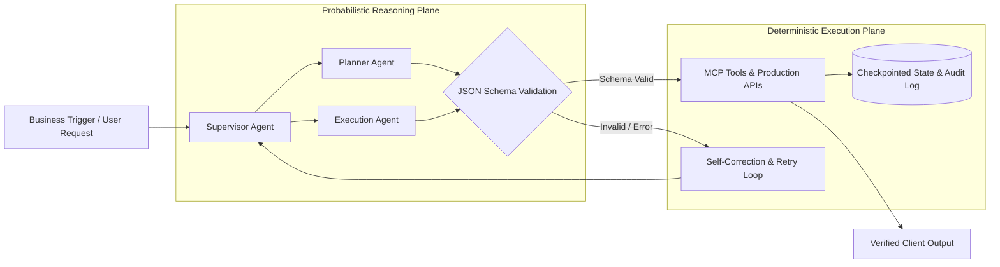

# Vikrant Kulle
### **AI Solutions Engineer & Custom Software Architect**
**Turning Complex Business Requirements into Reliable, Production-Ready Software & Agentic Workflows**

---

### 💡 Executive Summary & Value Proposition

> *"I help founders, businesses, and engineering leaders build custom software, implement practical AI agent workflows, and automate operational bottlenecks—from requirements discovery to live production deployment."*

I combine **3+ years of enterprise software engineering at Capgemini** (supporting Hartford Insurance's mission-critical Guidewire PolicyCenter platform) with hands-on full-stack development and practical agentic AI engineering.

* **Practical AI Engineering (No Hallucination Trap):** Stateful multi-agent systems (LangGraph), Model Context Protocol (MCP) integrations, and RAG pipelines engineered with strict JSON schema validation, retry loops, and human-in-the-loop checkpoints.
* **Enterprise SDLC & Mission-Critical Rigor:** Deep background in root-cause debugging, multi-tier impact analysis, regression testing, and high-reliability production deployments.
* **Dual Engineering + Quality Mindset:** I don't just build features—I design for edge cases, error recovery, and automated verification (Playwright, API test suites).
* **End-to-End Delivery Ownership:** Proven record taking ideas from initial concept to live cloud infrastructure (Next.js, FastAPI, Vercel, Cloudflare, Docker).

---

### 🚀 Live Commercial Deliveries & Production Systems

Here are production systems I've architected and deployed for commercial clients:

| Project | Category & Impact | Primary Tech Stack | Live Deployment |
| :--- | :--- | :--- | :---: |
| **Admissions Made Easy** | Student counseling & discovery platform guiding NEET/JEE aspirants through complex multi-quota counseling rules, cutoff analysis, and document validation. | Next.js, TypeScript, Tailwind CSS, REST APIs, Playwright | [🔗 Live Site](https://admissionsmadeeasy.in/) |
| **Anmol Enterprises** | Commercial PWA storefront and wholesale order management system for an authorized regional McCain Foods distributor. Sub-second mobile catalog with offline caching. | Next.js, React, Progressive Web App (PWA), Tailwind CSS | [🔗 Live Site](https://anmolenterprisess.in/) |
| **VS Techworks** | Venture platform and corporate client portal delivering custom web applications, workflow automation pipelines, and digital products. | React, Vite, Tailwind CSS, Cloudflare | [🔗 Live Site](https://vstechworks.co.in/) |
| **Seema's Abacus Academy** | Academy management portal and student enrollment inquiry system supporting student profiles and course discovery for a 22+ year institution. | Responsive Web, JavaScript, UI Testing, Cloud Hosting | [🔗 Live Site](https://seemas-abacus-academy.in.net/) |

---

### 🧠 Agentic AI Architecture: Dual-Plane Orchestration

When engineering AI solutions for clients, I enforce a **strict architectural boundary** between probabilistic reasoning and deterministic execution:

---

### 🛠️ Technical Arsenal & Core Competencies

<table>
  <tr>
    <td width="30%"><strong>🤖 AI Engineering & LLMs</strong></td>
    <td>
      <code>LangGraph</code> • <code>LangChain</code> • <code>Multi-Agent Systems</code> • <code>Model Context Protocol (MCP)</code> • <code>RAG Architecture</code> • <code>Tool / Function Calling</code> • <code>Structured JSON Outputs</code> • <code>OpenAI API</code> • <code>Anthropic Claude</code> • <code>Google Gemini</code> • <code>Groq</code> • <code>Prompt Engineering</code>
    </td>
  </tr>
  <tr>
    <td width="30%"><strong>🌐 Full-Stack & APIs</strong></td>
    <td>
      <code>Next.js</code> • <code>React</code> • <code>TypeScript</code> • <code>JavaScript</code> • <code>FastAPI</code> • <code>Python</code> • <code>Node.js</code> • <code>Tailwind CSS</code> • <code>REST APIs</code> • <code>PostgreSQL</code> • <code>Redis</code> • <code>Vite</code>
    </td>
  </tr>
  <tr>
    <td width="30%"><strong>🛡️ Enterprise SDLC & QA</strong></td>
    <td>
      <code>Playwright</code> • <code>Selenium</code> • <code>Page Object Model (POM)</code> • <code>API Testing</code> • <code>Root-Cause Analysis</code> • <code>Defect Triage</code> • <code>Guidewire PolicyCenter</code> • <code>Agile / Scrum Ceremonies</code>
    </td>
  </tr>
  <tr>
    <td width="30%"><strong>☁️ DevOps & Infrastructure</strong></td>
    <td>
      <code>Docker</code> • <code>Git</code> • <code>GitHub Actions (CI/CD)</code> • <code>Vercel</code> • <code>Cloudflare</code> • <code>Railway</code> • <code>Linux / Shell Scripting</code>
    </td>
  </tr>
</table>

---

### 💼 How I Work With Clients

1. **Clear Requirements & Architecture Discovery:** We align on the business outcome, technical constraints, and data contracts before writing a single line of code.
2. **Milestone-Driven Execution:** Regular updates, live preview environments, and rapid iteration with transparent communication.
3. **Bulletproof QA & Testing:** Automated test suites (Playwright) built into every web deliverable to prevent regressions.
4. **Clean Handoff & Cloud Deployment:** Production deployment, environment variable configuration, domain setup, and comprehensive documentation for your team.

---

### 📬 Let's Build Something Exceptional

Whether you need a **custom web application**, an **autonomous AI agent workflow**, or **enterprise-grade QA test automation**, I am available for freelance engagements and remote technical roles:

* 🌐 **Corporate Website:** [vstechworks.co.in](https://vstechworks.co.in/)
* 💼 **LinkedIn:** [linkedin.com/in/vikrant-kulle](https://linkedin.com/in/vikrant-kulle)
* ✉️ **Direct Email:** [vikrantkulle392000@gmail.com](mailto:vikrantkulle392000@gmail.com)
* 📞 **Direct Line:** `+91 7038251774`

  Built with enterprise rigor & modern engineering standards • © 2026 Vikrant Kulle

