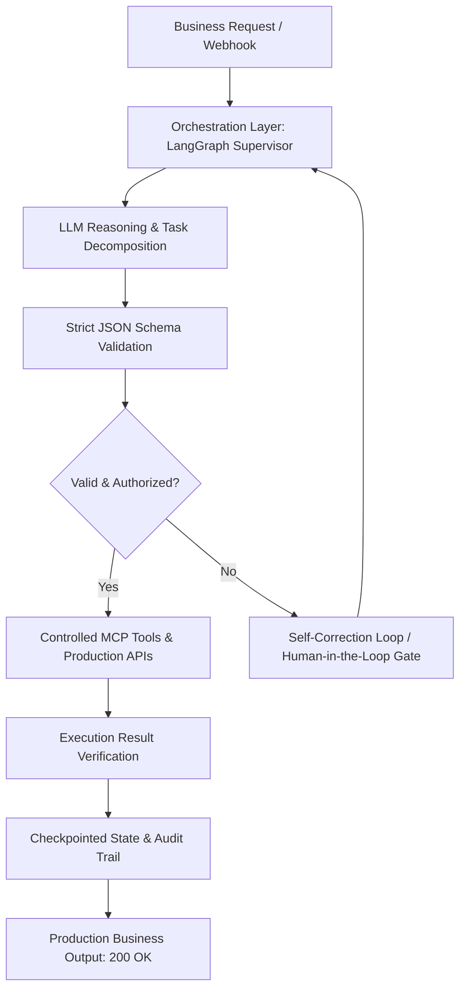

<div align="center">

<!-- WEBSITE HERO BROWSER FRAME -->
<a href="https://vstechworks.co.in">
  
</a>

<br/>

<!-- DYNAMIC TYPING ANIMATION -->
<a href="https://vstechworks.co.in">
  
</a>

<br/><br/>

<!-- QUICK ACTION BUTTONS -->
[](https://vstechworks.co.in/)
[](https://linkedin.com/in/vikrant-kulle)
[](mailto:vikrantkulle392000@gmail.com)
[](mailto:vikrantkulle392000@gmail.com)

<br/>

<!-- INTERACTIVE WEBSITE NAVIGATION BAR -->
<table>
  <tr>
    <td align="center"><b><a href="#-about-me--value-proposition">⚡ About</a></b></td>
    <td align="center"><b><a href="#-animated-ai-agent-orchestrator-in-action">🤖 Live Terminal</a></b></td>
    <td align="center"><b><a href="#-selected-commercial-projects-live">🚀 Live Projects</a></b></td>
    <td align="center"><b><a href="#-ai-engineering--system-architecture">🧠 AI Architecture</a></b></td>
    <td align="center"><b><a href="#-technical-skills--arsenal">🛠️ Tech Arsenal</a></b></td>
    <td align="center"><b><a href="#-enterprise-software-engineering-experience">🏢 Enterprise Experience</a></b></td>
    <td align="center"><b><a href="#-lets-build-together">📬 Contact</a></b></td>
  </tr>
</table>

</div>

---

### ⚡ About Me & Value Proposition

> **I build production-ready software, integrate AI into business workflows, and automate complex operations with enterprise reliability.**

I work with founders, growing businesses, and engineering leaders to turn business requirements into reliable software—from solution architecture and AI integration to testing, deployment, and ongoing improvement.

I combine enterprise software engineering experience supporting mission-critical insurance underwriting and core policy platforms with hands-on development of commercial web applications, business automation pipelines, and stateful AI-powered solutions.

#### 🎯 What I Bring to a Client Engagement:
* **AI Engineering & Integration:** Stateful agent workflows (LangGraph), Model Context Protocol (MCP) tool binding, structured JSON outputs, retrieval-augmented generation (RAG), and cost/latency tracking.
* **Custom Software Development:** Full-stack web applications, business portals, progressive web apps (PWAs), and scalable REST APIs (Next.js, FastAPI, Node.js).
* **Workflow Automation:** Replacing repetitive manual operational bottlenecks with deterministic, auditable software pipelines.
* **Quality & SDET Engineering:** Automated UI and API testing (Playwright, Selenium), regression prevention, failure recovery, and production-readiness validation.
* **End-to-End Delivery Ownership:** Requirements discovery, technical architecture, clean implementation, zero-downtime deployment, and comprehensive handover documentation.

---

### 🤖 Animated AI Agent Orchestrator (In Action)

When clients ask how I engineer AI, I demonstrate this core principle: **probabilistic reasoning must be bound to deterministic execution tools with strict validation**.

<div align="center">
  
</div>

---

### 🚀 Selected Commercial Projects (Live in Production)

Below are production systems and commercial software platforms I have architected, developed, and deployed for businesses:

<table>
  <!-- PROJECT 1 -->
  <tr>
    <td width="55%" valign="top">
      <h3>1. Admissions Made Easy</h3>
      <b>Education Technology • Admissions &amp; Counselling Platform</b><br/>
      <a href="https://admissionsmadeeasy.in/"><code>https://admissionsmadeeasy.in/</code></a>
      <br/><br/>
      A high-impact digital platform helping thousands of students navigate complex medical (NEET) and engineering admissions through college discovery, quota cutoff analysis, counselling guidance, and digital support.
      <ul>
        <li>Engineered candidate profile management, cutoff predictors, and multi-stage quota counselling logic.</li>
        <li>Built with automated regression suites and smoke tests using <b>Playwright</b>, ensuring zero downtime during peak counseling rushes.</li>
      </ul>
      <b>Stack:</b> <code>Next.js</code> • <code>TypeScript</code> • <code>Tailwind CSS</code> • <code>REST APIs</code> • <code>Playwright</code>
    </td>
    <td width="45%" align="center" valign="middle">
      <br/>
      <a href="https://admissionsmadeeasy.in/">
        
      </a>
      <br/><br/>
      <a href="https://admissionsmadeeasy.in/">
        
      </a>
      <br/><br/>
      <sub>High-traffic counseling &amp; quota cutoff system</sub>
    </td>
  </tr>

  <!-- PROJECT 2 -->
  <tr>
    <td width="55%" valign="top">
      <h3>2. Anmol Enterprises</h3>
      <b>B2B &amp; B2C Commerce • Progressive Web Application (PWA)</b><br/>
      <a href="https://anmolenterprisess.in/"><code>https://anmolenterprisess.in/</code></a>
      <br/><br/>
      Commercial storefront and wholesale order management platform engineered for an authorized regional food distributor (McCain Foods distributor, Latur).
      <ul>
        <li>Built fast product catalog discovery, categorized filters, and mobile-optimized ordering flows.</li>
        <li>Implemented offline Progressive Web App (PWA) caching for sub-second mobile ordering.</li>
      </ul>
      <b>Stack:</b> <code>Next.js</code> • <code>React</code> • <code>TypeScript</code> • <code>Tailwind CSS</code> • <code>PWA</code>
    </td>
    <td width="45%" align="center" valign="middle">
      <br/>
      <a href="https://anmolenterprisess.in/">
        
      </a>
      <br/><br/>
      <a href="https://anmolenterprisess.in/">
        
      </a>
      <br/><br/>
      <sub>Regional McCain Foods distribution PWA</sub>
    </td>
  </tr>

  <!-- PROJECT 3 -->
  <tr>
    <td width="55%" valign="top">
      <h3>3. VS Techworks</h3>
      <b>Software Solutions Venture • Digital Products &amp; Automation</b><br/>
      <a href="https://vstechworks.co.in/"><code>https://vstechworks.co.in/</code></a>
      <br/><br/>
      The software solutions venture through which I develop custom web applications, workflow automation pipelines, client portals, and digital platforms for businesses.
      <ul>
        <li>Deliver tailored full-stack software and automation solutions for international clients.</li>
        <li>Manage cloud hosting, environment security, and zero-downtime deployment pipelines.</li>
      </ul>
      <b>Stack:</b> <code>React</code> • <code>Vite</code> • <code>TypeScript</code> • <code>Tailwind CSS</code> • <code>Cloudflare</code>
    </td>
    <td width="45%" align="center" valign="middle">
      <br/>
      <a href="https://vstechworks.co.in/">
        
      </a>
      <br/><br/>
      <a href="https://vstechworks.co.in/">
        
      </a>
      <br/><br/>
      <sub>Software services &amp; automation venture</sub>
    </td>
  </tr>

  <!-- PROJECT 4 -->
  <tr>
    <td width="55%" valign="top">
      <h3>4. Seema's Abacus Academy</h3>
      <b>Education • Academy Management &amp; Student Enquiries</b><br/>
      <a href="https://seemas-abacus-academy.in.net/"><code>https://seemas-abacus-academy.in.net/</code></a>
      <br/><br/>
      Responsive digital platform and student inquiry portal for an established 22+ year abacus and brain development institution.
      <ul>
        <li>Structured educational content, student discovery checklists, and responsive inquiry capture.</li>
        <li>Rigorous cross-device UI testing and performance optimization.</li>
      </ul>
      <b>Stack:</b> <code>JavaScript</code> • <code>Responsive Web Design</code> • <code>UI Testing</code> • <code>Cloud Hosting</code>
    </td>
    <td width="45%" align="center" valign="middle">
      <br/>
      <a href="https://seemas-abacus-academy.in.net/">
        
      </a>
      <br/><br/>
      <a href="https://seemas-abacus-academy.in.net/">
        
      </a>
      <br/><br/>
      <sub>22+ year academy management system</sub>
    </td>
  </tr>
</table>

---

### 🧠 AI Engineering & System Architecture

#### Reliable AI Workflows With Deterministic Guardrails
I approach AI integration as a **rigorous software engineering problem**—not simply a prompt-writing exercise. The objective is to combine LLM reasoning with controlled tool execution, validated data contracts, observable workflows, and recoverable failures.



#### Core Architectural Guarantees:
* **Schema Validation:** Strict Pydantic / JSON schemas for structured model outputs before tool triggering.
* **Controlled Protocol Execution:** Dynamic tool binding via **Model Context Protocol (MCP)** ensuring sandbox safety.
* **Deterministic Fallbacks:** Explicit retry backoffs, circuit breakers, and human-in-the-loop checkpoints for sensitive transactions.
* **Auditability & Observability:** Checkpointed state graphs enabling complete step-level replayability.

---

### 🛠️ Technical Skills & Arsenal

<table>
  <tr>
    <td width="28%"><strong>🤖 AI Engineering</strong></td>
    <td>
      <code>LangGraph</code> • <code>LangChain</code> • <code>Model Context Protocol (MCP)</code> • <code>RAG Architecture</code> • <code>Tool Calling</code> • <code>Structured JSON Outputs</code> • <code>Prompt Engineering</code> • <code>OpenAI API</code> • <code>Anthropic Claude</code> • <code>Google Gemini</code> • <code>Groq</code>
    </td>
  </tr>
  <tr>
    <td width="28%"><strong>🌐 Frontend &amp; Web</strong></td>
    <td>
      <code>React</code> • <code>Next.js</code> • <code>TypeScript</code> • <code>JavaScript</code> • <code>Tailwind CSS</code> • <code>Progressive Web Apps (PWA)</code> • <code>Vite</code> • <code>HTML5/CSS3</code>
    </td>
  </tr>
  <tr>
    <td width="28%"><strong>⚙️ Backend &amp; APIs</strong></td>
    <td>
      <code>Python</code> • <code>FastAPI</code> • <code>Node.js</code> • <code>REST APIs</code> • <code>JSON Schema</code> • <code>PostgreSQL</code> • <code>Redis</code> • <code>Vector Search</code>
    </td>
  </tr>
  <tr>
    <td width="28%"><strong>🛡️ Quality Engineering</strong></td>
    <td>
      <code>Playwright</code> • <code>Selenium</code> • <code>Page Object Model (POM)</code> • <code>REST API Testing</code> • <code>Root-Cause Analysis</code> • <code>Defect Triage</code> • <code>Regression Verification</code>
    </td>
  </tr>
  <tr>
    <td width="28%"><strong>🏢 Enterprise Platforms</strong></td>
    <td>
      <code>Guidewire PolicyCenter</code> • <code>InsuranceSuite</code> • <code>P&amp;C Insurance Lifecycles</code> • <code>Agile / Scrum</code> • <code>Enterprise SDLC Controls</code>
    </td>
  </tr>
  <tr>
    <td width="28%"><strong>☁️ DevOps &amp; Cloud</strong></td>
    <td>
      <code>Docker</code> • <code>Git</code> • <code>GitHub Actions (CI/CD)</code> • <code>Vercel</code> • <code>Cloudflare</code> • <code>Railway</code> • <code>Linux / Shell</code>
    </td>
  </tr>
</table>

---

### 🏢 Enterprise Software Engineering & Production Systems

#### **Core Policy Administration & Mission-Critical Workflows**
**Senior Software Engineer • Enterprise Insurance Systems**

* Supported mission-critical policy administration lifecycles and complex business-driven configuration changes on enterprise core platforms.
* Investigated production and development defects through structured root-cause analysis, log debugging, and functional testing across core workflows and multi-tier integration touchpoints.
* Executed defect resolution and regression verification, evaluating multi-tier impacts to ensure uninterrupted system stability across iterative releases.
* Collaborated closely with cross-functional developers, business analysts, QA teams, and enterprise stakeholders in Agile/Scrum sprint ceremonies.
* Upheld strict enterprise SDLC controls, release verification standards, code reviews, and technical documentation.

---

### 📬 Let's Build Together

I am currently open to **custom software projects, AI agent implementations, workflow automation consulting, and contract engineering roles**.

<div align="center">

[](https://vstechworks.co.in/)
[](mailto:vikrantkulle392000@gmail.com)
[](https://linkedin.com/in/vikrant-kulle)

<br/>

**Direct Contact:** `vikrantkulle392000@gmail.com` • `+91 7038251774` • [vstechworks.co.in](https://vstechworks.co.in/)

<br/>

```
┌────────────────────────────────────────────────────────────────────────┐
│  Designed with enterprise rigor & modern web engineering standards    │
│  © 2026 Vikrant Kulle • All rights reserved                           │
└────────────────────────────────────────────────────────────────────────┘
```

</div>
